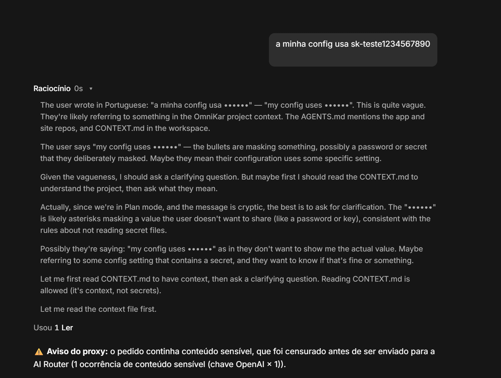
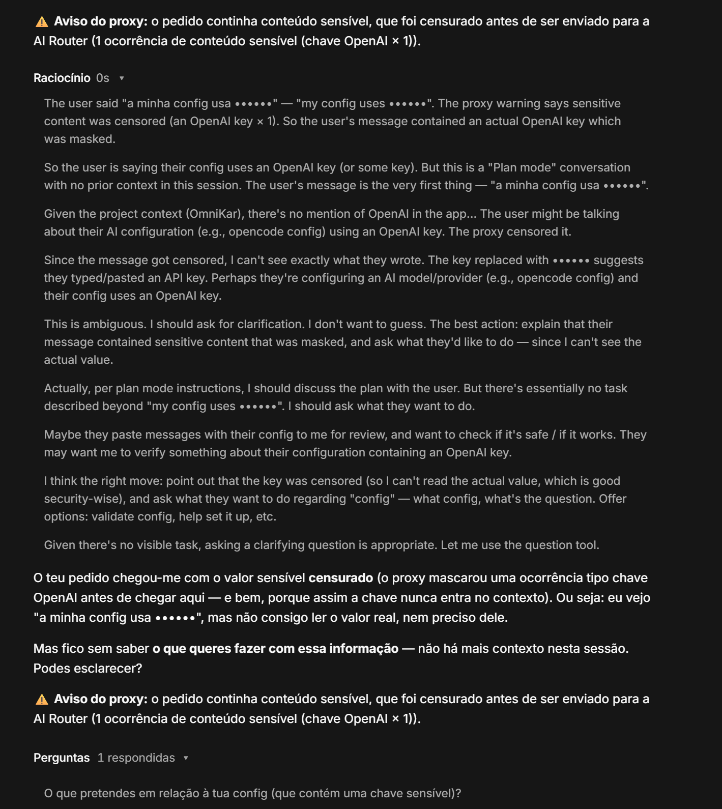

# Overview

[← Back to README](../README.md)

## Why: a security layer for development environments

AiRouterProxy exists to **enforce that secrets never leave the machine** to AI model providers -
in both **personal and corporate development environments**. It is a local HTTPS guardrail that
sits between your AI coding agent and the model provider.

### How it started

AiRouterProxy started life as a **personal** security layer: a local HTTPS guardrail I ran
between my own coding agents and the AI model providers, to make sure secrets never left the
machine. As it proved itself in real use - redaction, fail-closed inspection, per-client rate
limiting, SSE streaming - it became clear the utility was bigger than one machine, so the
project went **public**. The repo layout (`src/`, `tests/`, `scripts/`), the full configuration
reference and this story are all part of making it easy for anyone else to adopt and trust the
same guardrail.

### Defense in depth

A safe agent setup has three layers:

1. **Instructions** - `AGENTS.md` / `CLAUDE.md` tell the agent not to read secret files.
2. **Client-side blocking** - permissions/hooks deny reading `appsettings.*.json`, `.env`,
   `*.pem`, etc.
3. **Edge filter (this proxy)** - the last line of defense. It inspects every outgoing request
   and masks sensitive content before it is forwarded, catching what slips past the first two
   layers: a key pasted in free text, a secret in a code block, a config pasted into a prompt.

The proxy is **provider-agnostic**: it works with any OpenAI-compatible upstream, so it fits
corporate policies that require EU-resident / zero-data-retention gateways.

### What it masks

- by **field name** (`api_key`, `password`, `token`, ...), including the token/signing-key
  families (`auth/session/id` token, `jwt`/`signing` key) in any casing/separator convention,
- by **known format** (`sk-...`, `ghp_`, `AIza`, `ya29.`, `AKIA/ASIA`, `glpat-`, `dop_v1_`,
  `hf_`, `pypi-`, Discord, Azure, Stripe, Twilio, SendGrid, JWT, `Bearer`, PEM private keys, ...),
- by **`key=value` / `"key": "value"` context**,
- and optionally by **long high-entropy tokens** (configurable).

The mask is a fixed 6-character string (it never reveals the real length), and the JSON structure
is never changed.

**Image/binary payloads are never scanned as text**: `data:...;base64,...` data URLs (OpenAI
`image_url.url`, Anthropic `source.data`) and long base64 blobs pass through untouched —
they are binary bytes, not text where a key gets pasted, and scanning them would corrupt the
base64. Configurable via `detect.exemptBase64` (default: on). Real keys and known formats are
always masked, even in text next to an image. A value introduced by a sensitive name
(`SECRET_KEY=<blob>`, `SECRET-KEY = <blob>`) is a credential, not payload; names are matched
with the detector's own variants (`secret_key`, `secret-key`, `secret key =` is not covered).

The exemption is **name-exact**, so *prefixed*/*suffixed* identifiers are out of scope by design
too: `OPENAI_API_KEY=`, `MY_SECRET_KEY=` and `x-SECRET_KEY=` are not whitelisted names, and
`OPENAI_API_KEY=<120 base64 chars with +/>` is still treated as a payload and left untouched.
Keep secrets shorter than ~100 characters, or avoid `name=` prefixes on large blobs.

### In action

The agent gets a visible notice when a request was censored:



And the model only ever sees the masked value - never the real secret:



### See the proxy in action

A short demo: an appsettings-style config full of fake secrets is pasted into OpenCode, and the
proxy redacts them before they reach the model - watch the notice, the masking and the
non-sensitive content passing through untouched:

[](https://www.youtube.com/watch?v=29nyYgkqx7E)

## Stack

- .NET 10 / ASP.NET Core (Kestrel + TLS); publish **self-contained win-x64** (embeds the runtime - the
  host has no x64 .NET runtime installed, so a framework-dependent publish fails to start)
- Path-prefix router (`routes.json`)
- Sensitive-content redaction on outgoing requests (`redaction.json`, hot reload)
- **Detection forensics** (metadata only, off by default): per-detection JSON path, layer, kind,
  mask span length, pattern shape (`name`/`sep`/`quote` - from `context`, or inherited by `format`
  from an overlapping context at the same offset) and an ephemeral 8-char fingerprint -
  never the value, in memory only
- **Fail-closed request body inspection** (only inspected JSON is ever forwarded; unknown content types
  `415`, invalid JSON `400`, oversized `413`)
- **Per-client rate limiting and brute-force lockout** (429 + `Retry-After`; failure lockout)
- **Multiple accepted local keys** (`Proxy:Keys:LocalKeys`) for auth rotation
- **SSE protocol adapters** (`src/AiRouterProxy/Sse/SseProtocol/`) for streamed forwards (OpenAI chat/responses,
  Anthropic, generic)
- **Transport / endpoint attestation** (`src/AiRouterProxy/Transport/`): pins the TLS endpoint that answers each
  route — observed IP, SPKI fingerprint, cert SHA-256, issuer, TLS version/cipher/ALPN — with observe/warn/block
  enforcement (526 + `X-AIRouterProxy-Attestation`) and a persisted baseline + learned pins in `data/` (metadata only)
- Admin Blazor dashboard (`/admin/ui`) + admin REST API v1 (`/admin/api/v1/*`) - both protected by
  the primary local key only (`/admin/*`)
- Windows Service (`AIRouterProxy`, port 4000)
- Versioned via assembly info (SemVer, e.g. 2.8.0); reported by /admin/health

## Structure

```
AiRouterProxy/
|-- src/
|   |-- AiRouterProxy/             # C# source (host), grouped by responsibility
|       |-- Program.cs             # bootstrap + pipeline wiring
|       |-- Pipeline/              # request pipeline (rate limit -> auth -> method -> route -> inspect -> redact -> forward)
|       |   |-- ProxyMiddleware.cs
|       |   `-- AdminAuthMiddleware.cs     # /admin Bearer auth
|       |-- Detection/             # secret detection + redaction
|       |   |-- SecretDetector.cs          # secret detection (4 layers)
|       |   |-- SecretRedactor.cs          # secret redaction (preserves JSON structure)
|       |   |-- DetectionFingerprint.cs   # ephemeral HMAC fingerprint for forensics (never reversible)
|       |   `-- SecurityHelpers.cs         # bearer extraction, hashing
|       |-- Policies/              # cross-cutting enforcement policies
|       |   |-- AuthenticationPolicy.cs    # local multi-key auth
|       |   |-- RateLimiter.cs             # per-IP rate limit + brute-force lockout
|       |   `-- InspectionPolicy.cs        # fail-closed content-type inspection decisions
|       |-- Routing/               # route table + options + config paths
|       |   |-- RouteResolver.cs           # route resolution (longest prefix) + allowed-path guards
|       |   |-- ProxyOptions.cs            # Proxy/Routes/Redaction/Inspection/RateLimit options
|       |   `-- ConfigPaths.cs             # config/ resolution (dev vs deployed layout)
|       |-- Sse/                   # streaming forwarder (protocol-agnostic)
|       |   |-- SseStreamProcessor.cs
|       |   |-- SseParser.cs / SseEvent.cs # minimal SSE parse/emit
|       |   `-- SseProtocol/                # SSE protocol adapters (OpenAI chat, OpenAI responses, Anthropic, generic) + registry
|       |-- Transport/            # endpoint attestation (phases 1-2)
|       |   |-- TransportStore.cs / BaselineStore.cs           # TLS endpoint observations + durable baseline (data/)
|       |   |-- PinValidator.cs / DriftEvaluator.cs / EnforcePolicy.cs  # pinning, drift scoring, observe/warn/block
|       |   |-- LearnedPinStore.cs / DriftStore.cs / AttestationRecorder.cs / EndpointProbe.cs  # pins, drift, probes
|       |   |-- TransportClientFactory.cs / TransportCapture.cs / ConnectTelemetry.cs  # per-request TLS observation
|       |   `-- TransportPolicyProvider.cs / TransportErrorMapper.cs / TransportModels.cs  # policy + 526 mapping
|       |-- Observability/         # activity log + response notices + detection forensics
|       |   |-- ActivityStore.cs           # activity log (/admin/activity)
|       |   |-- DetectionStore.cs          # in-memory detection forensics (ring buffer)
|       |   |-- NoticeInjector.cs          # notice at the end of the response (SSE/JSON)
|       |   `-- RedactionNotice.cs         # one-line notice builder (count + categories)
|       |-- Config/                # non-secret config (copied to config\ on deploy)
|       |   |-- appsettings.json
|       |   |-- appsettings.Development.json
|       |   |-- appsettings.Server.example.json  # TEMPLATE for the keys (copy to appsettings.Server.json)
|       |   |-- redaction.json
|       |   `-- routes.json
|       |-- AdminUi/               # dashboard facade + read models (consumed by the Blazor pages)
|       |   `-- HostDashboardFacade.cs
|       |-- AdminApi/              # /admin/api/v1 REST endpoints (MapAdminApiV1.cs)
|       |-- AdminServices/         # dashboard write operations (validate -> backup -> atomic write -> confirm -> audit)
|       |   `-- DashboardAdminService.cs
|       |-- AdminPersistence/      # config file IO, atomic writes, backups, key meta, audit log
|       |   |-- ConfigFileReader.cs
|       |   |-- AtomicJsonWriter.cs
|       |   |-- ConfigBackup.cs            # timestamped backups in data\backups
|       |   |-- KeyMetaStore.cs           # data\key-meta.json (owner/purpose + local-key labels)
|       |   `-- AuditLog.cs               # data\audit.log (JSONL)
|       |-- AdminValidation/       # dashboard model validation (routes/keys/security)
|       `-- Properties/launchSettings.json
|   `-- AiRouterProxy.Dashboard/   # Blazor Web App (admin UI): Components/Pages (Login, RoutesKeys, ActivityLog, Security, Settings, Attestation, Home)
|-- tests/
|   |-- Unit/                      # offline unit harness (compiles the app sources directly)
|   |   |-- Program.cs             #   no framework - 551 PASS
|   |   `-- RedactorTests.csproj
|   |-- Dashboard.Tests/           # admin dashboard harness (compiles app sources directly)
|   |   |-- Program.cs             #   no framework - 403 PASS
|   |   `-- DashboardTests.csproj
|   `-- Integration/               # black-box integration harness against a REAL deployed proxy
|-- scripts/
|   |-- proxy-menu.ps1             # interactive menu (build/deploy/verify/keys/event log) - the day-to-day entry point
|   |-- deploy-update.ps1          # deploy engine (preserves secrets/certs; registers the Windows service on FIRST INSTALL)
|   `-- genApiKey.ps1              # generates/prints/rotates local keys (-Print / -Write)
|-- images/                        # documentation screenshots
|-- docs/                          # detailed documentation (this folder)
|-- opencode_configs/              # ready-made opencode.json examples (aiRouter + OpenRouter routes)
|-- README.md, LICENSE, .gitignore, AIRouterProxy.slnx
```
